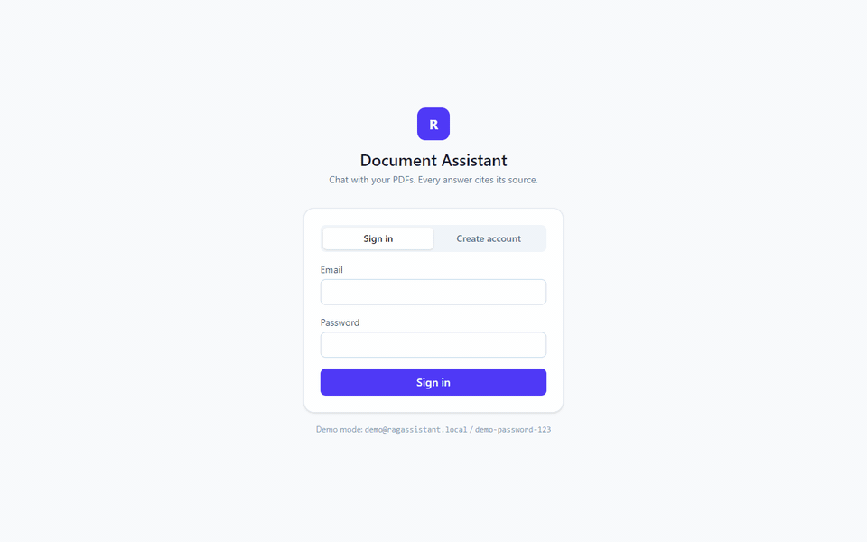
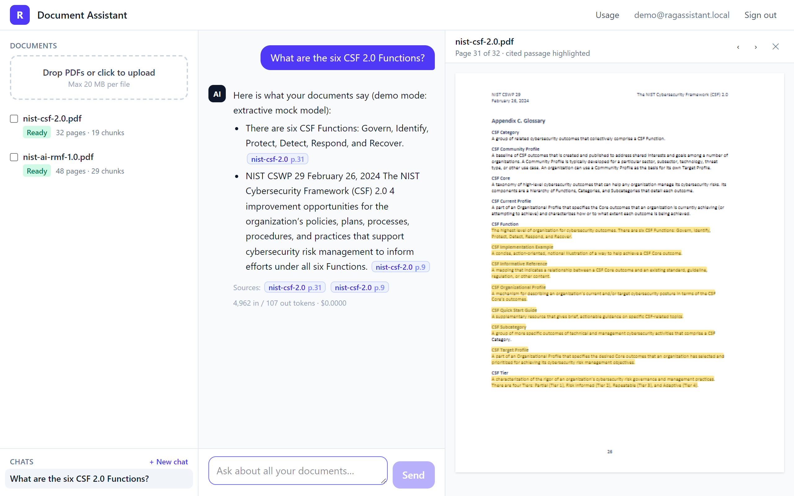
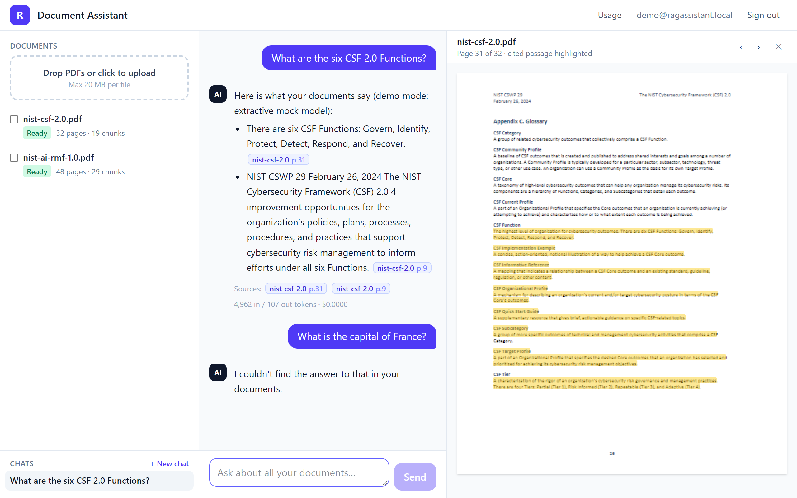
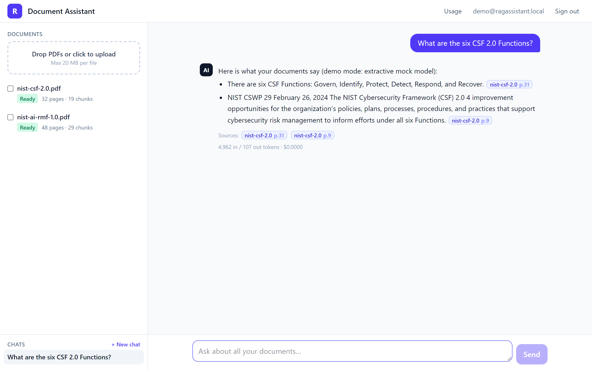
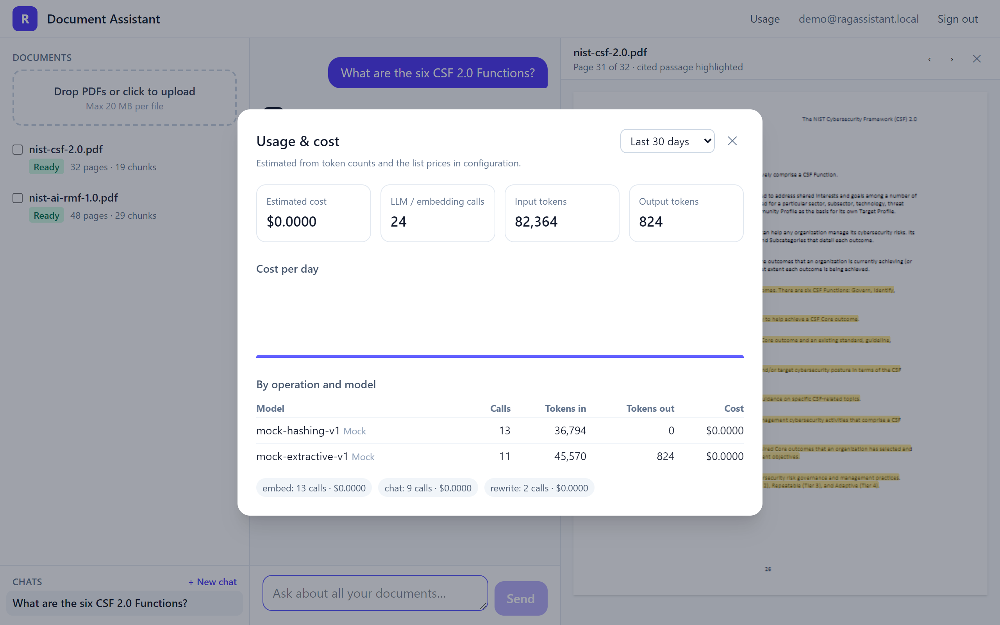
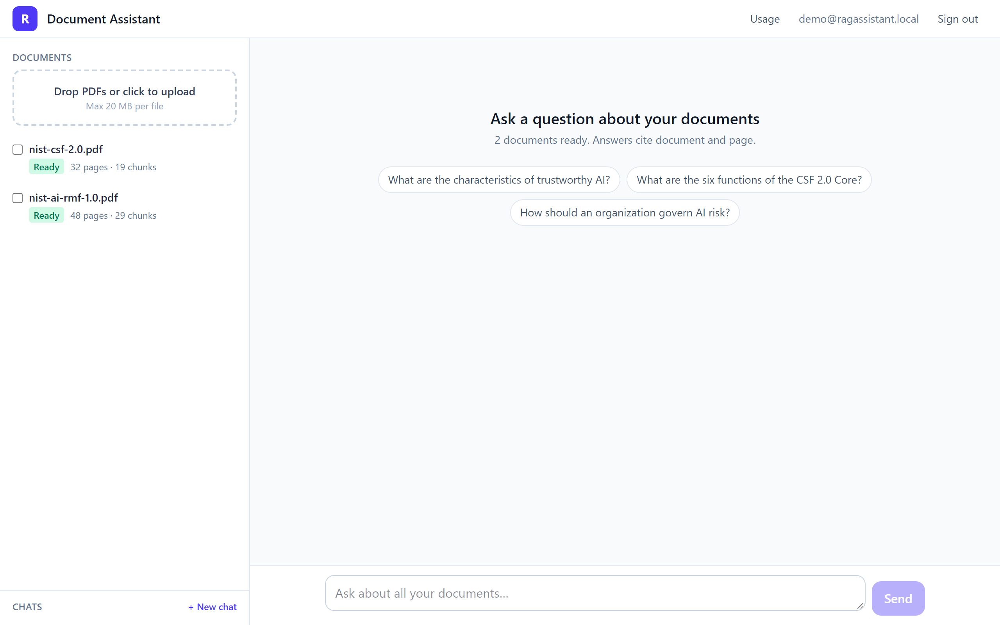
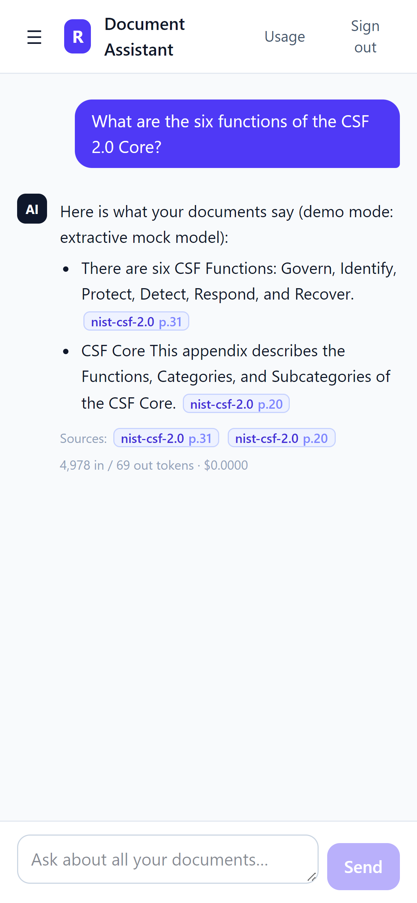
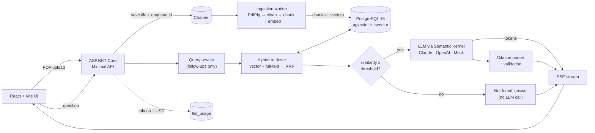

<div align="center">

# RAG Document Assistant

### Chat with your PDFs. Every answer cites its page.

A self-hosted document Q&A system built with **.NET 10**, **Semantic Kernel**, **Claude / OpenAI** and **PostgreSQL + pgvector**. Answers stream token by token, every claim links to the exact page of the source PDF, and if the answer isn't in your documents the assistant says so instead of making one up.

[](https://github.com/Yusufislamyetkin/dotnet-rag-document-assistant/actions/workflows/ci.yml)


[**Quick start**](#quick-start) · [**Features**](#features) · [**Architecture**](#architecture) · [**Evaluation**](#evaluation) · [**API**](#api)

<br>



</div>

---

## Why this exists

Companies keep their knowledge in PDFs: policies, contracts, manuals, standards. Finding one answer means opening several files and searching by hand. Generic chatbots answer fast, but they can't show where an answer came from, and they invent things when they don't know.

RAG Document Assistant is built to be **trusted**:

| | |
|---|---|
| 🔎 **Traceable** | Every answer cites `[document:page]`. Citations are validated against the passages the model actually saw; one click opens the PDF at that page with the passage highlighted. |
| 🙅 **Honest** | When nothing relevant is retrieved, the user gets *"I couldn't find the answer to that in your documents"*, and no LLM call is made. |
| 💸 **Cost-aware** | Every LLM and embedding call is logged with tokens, latency and estimated USD, per user, per model and per day. |
| 🔐 **Isolated** | JWT auth; every query is scoped to the signed-in user's own documents. Rate limits per user. |
| 🔌 **Provider-agnostic** | Claude or OpenAI is a configuration switch. With no key at all, the full app runs offline in demo mode. |

## Screenshots

<table>
  <tr>
    <td width="50%"><br><sub><b>Click a citation</b>: the viewer jumps to page 31 and highlights the cited passage.</sub></td>
    <td width="50%"><br><sub><b>No hallucinations</b>: an off-topic question gets "not found", with zero LLM tokens spent.</sub></td>
  </tr>
  <tr>
    <td width="50%"><br><sub><b>Streaming answers</b> with inline citation chips and per-answer token/cost stats.</sub></td>
    <td width="50%"><br><sub><b>Usage & cost panel</b>: tokens and estimated USD by operation, model and day.</sub></td>
  </tr>
  <tr>
    <td width="50%"><br><sub><b>Workspace</b>: drag-and-drop upload, ingestion status, page and chunk counts.</sub></td>
    <td width="50%" align="center"><br><sub><b>Responsive</b>: the same experience on a phone.</sub></td>
  </tr>
</table>

> The screenshots and GIF were recorded in demo mode (offline mock model), which is why answers start with "demo mode: extractive mock model". With an API key configured, the same UI shows answers written by Claude or GPT. A video version is in [`docs/images/demo.mp4`](docs/images/demo.mp4).

## Features

| Area | What you get |
|---|---|
| **Upload** | Multi-file drag-and-drop upload, 20 MB per file, extension + `%PDF-` magic-byte validation, SHA-256 de-duplication per user |
| **Ingestion** | Background worker on `System.Threading.Channels`; status `Uploaded → Processing → Ready / Failed` with the error message; unfinished work is re-queued on restart; failed documents can be retried |
| **Extraction** | PdfPig with layout analysis (Docstrum blocks + reading order), so multi-column pages read correctly; de-hyphenation and whitespace cleanup |
| **Chunking** | ~800 tokens with 100-token overlap, never splits mid-sentence; each chunk stores its page range, character offsets and a per-page map |
| **Embeddings** | OpenAI `text-embedding-3-small` through Semantic Kernel, batched, Polly retry with exponential backoff + jitter on 429/5xx |
| **Retrieval** | pgvector cosine (HNSW index) + PostgreSQL full-text search (GIN index), merged with Reciprocal Rank Fusion; configurable top-k; optional filter by selected documents |
| **Chat** | Persisted sessions; follow-up questions rewritten into standalone search queries; grounded system prompt; answers streamed over Server-Sent Events |
| **Citations** | Parsed from the answer, validated against retrieved chunks (invalid ones dropped and counted), returned as structured JSON; UI chips open the viewer at the page with the passage highlighted |
| **"I don't know"** | Below a similarity threshold the API answers "not found" without calling the LLM; the prompt also instructs the model to use the same sentence |
| **Auth** | ASP.NET Core Identity + JWT bearer; every query filtered by user id |
| **Guardrails** | Per-user rate limiting (chat, search, upload), per-IP limiting (auth), max question length, document text escaped and fenced as untrusted data (prompt-injection defence) |
| **Observability** | `llm_usage` table with tokens, USD and latency per call; `/api/usage` + usage panel; Serilog; OpenTelemetry traces and metrics (OTLP); `/health` with a database check |
| **Providers** | `Anthropic` (default `claude-sonnet-5-5`, official Anthropic C# SDK), `OpenAI`, or `Mock`, all behind Semantic Kernel's `IChatCompletionService` |

## Architecture



Clean Architecture split:

```
src/
  RagAssistant.Domain/          entities (Document, DocumentChunk, ChatSession, ChatMessage, LlmUsage)
  RagAssistant.Application/     chunker, RRF, prompt builder, citation parser, chat/ingestion/usage services, ports
  RagAssistant.Infrastructure/  EF Core + migrations, pgvector/FTS SQL, PdfPig, Semantic Kernel providers, worker, Identity/JWT
  RagAssistant.Api/             Minimal API endpoints, SSE, auth, rate limiting, Serilog, OpenTelemetry
web/                            React + TypeScript + Tailwind, react-pdf viewer
eval/                           evaluation harness + golden set
tests/                          xUnit unit tests, Testcontainers integration tests
samples/                        public-domain PDFs used for the demo and the eval
```

## Key design decisions

**Hybrid search, not vectors alone.** Embeddings capture meaning but miss exact terms such as product codes, clause numbers and acronyms like "C-SCRM". PostgreSQL full-text search catches those. Both result lists are merged with Reciprocal Rank Fusion, which only uses ranks, so cosine similarity and `ts_rank` never need a common scale and there is no weight to tune. Everything lives in one PostgreSQL: no separate vector database to run or pay for.

**Sentence-aware chunks with page maps.** Chunks are packed from whole sentences up to ~800 tokens, and the last ~100 tokens repeat at the start of the next chunk, so a fact on a chunk border stays retrievable with its context. Each chunk records where every page starts inside it, and the prompt marks pages with `<page n="12"/>`. The model can cite the exact page even when a chunk spans two pages, and the viewer highlights only that page's text.

**Provider abstraction.** The application depends on its own `IChatModel` / `IEmbeddingService` ports; infrastructure implements them on top of Semantic Kernel's `IChatCompletionService` and `IEmbeddingGenerator`. Claude has its own connector on the official Anthropic SDK. Switching provider is one setting (`Llm__Provider`). The same seam powers demo mode and the integration tests, which need no API key.

**Cost control by design.** Questions with no relevant passage never reach the LLM. Only follow-ups pay for a query rewrite, which can run on a cheaper model (`Llm__Anthropic__RewriteModel`). Claude is called with low effort for short grounded answers, answer length is capped, rate limits are per user, and every call is recorded with its estimated cost.

**Prompt-injection defence.** Document text is treated as untrusted. `<` and `>` inside documents are replaced, so a PDF cannot close its `<source>` block or forge `<page>` markers. The system prompt states that source content is data, never instructions, and the user's question sits after the sources in its own tag.

## Evaluation

Quality is measured, not assumed. `eval/` contains a console harness and a golden set of **21 questions** over the two sample PDFs: 18 answerable (with the expected document and page) and 3 deliberately unanswerable. The harness runs every question through the real HTTP API (`/api/search` and the SSE chat endpoint) and reports:

- **Retrieval hit-rate@k** and **MRR**: is the gold page inside the top-k chunks, and how high?
- **Citation correctness**: does at least one citation name the gold document and page (±1)?
- **"Not found" accuracy** on the unanswerable questions.
- **Faithfulness**: an LLM judge scores whether every claim is supported by the cited passages (0–1).

**Offline baseline** (hashed bag-of-words embeddings + extractive mock model, `k = 6`):

| Metric | Result |
|---|---|
| Retrieval hit-rate@6 | 94% (17/18) |
| Mean reciprocal rank | 0.82 |
| Answered on answerable questions | 89% (16/18) |
| Citation correctness (gold document, page ±1) | 61% (11/18) |
| Correct "not found" on unanswerable questions | 100% (3/3) |

The offline baseline measures the pipeline itself (chunking, hybrid retrieval, RRF, citation validation, the not-found gate) with deterministic stand-ins, so every change can be checked without spending tokens. Run the same harness against your provider to benchmark real models; it writes the report to `eval/results/latest.md`:

```bash
# API running with real providers (see Quick start), then:
export Llm__Provider=Anthropic Llm__Anthropic__ApiKey=...      # judge model for faithfulness
dotnet run --project eval/RagAssistant.Eval -- --api http://localhost:5080 --k 6
```

## Quick start

Requires Docker. One command:

```bash
git clone https://github.com/Yusufislamyetkin/dotnet-rag-document-assistant.git
cd dotnet-rag-document-assistant
docker compose up --build
```

Open <http://localhost:8080> and sign in with `demo@ragassistant.local` / `demo-password-123`. Two sample PDFs are already ingested, so you can ask questions right away. Without API keys the app runs in **demo mode** (offline mock LLM + hashed embeddings).

**Use real models:** copy `.env.example` to `.env`, set `ANTHROPIC_API_KEY` and/or `OPENAI_API_KEY`, and run `docker compose up` again. Keys are read only from environment variables or user-secrets and are never stored in the repository.

> Switching the embedding provider changes the vector space. Documents embedded with another model are ignored by retrieval: re-upload them, or delete the `pgdata` volume so they are embedded again.

Local development without Docker for the API:

```bash
docker compose up -d postgres
dotnet user-secrets --project src/RagAssistant.Api set "Llm:Anthropic:ApiKey" "<your key>"   # optional
dotnet run --project src/RagAssistant.Api            # http://localhost:5080
npm --prefix web install && npm --prefix web run dev  # http://localhost:5173 (proxies /api)
```

## Configuration

Every setting can be overridden with an environment variable (`Section__Key`).

| Setting | Default | Description |
|---|---|---|
| `Llm__Provider` | `Auto` | `Auto` · `Anthropic` · `OpenAI` · `Mock`. `Auto` picks Anthropic if its key is set, else OpenAI, else Mock |
| `Llm__Anthropic__ApiKey` / `__Model` | – / `claude-sonnet-5-5` | Claude answer model |
| `Llm__Anthropic__RewriteModel` | same as `Model` | Optional cheaper model for query rewriting |
| `Llm__OpenAI__ApiKey` / `__ChatModel` | – / `gpt-4.1-mini` | OpenAI answer model |
| `Embeddings__Provider` | `Auto` | `Auto` · `OpenAI` · `Mock` |
| `Embeddings__OpenAI__ApiKey` / `__Model` | – / `text-embedding-3-small` | Embedding model (vector column is 1536-d) |
| `Ingestion__ChunkTokens` / `__ChunkOverlapTokens` | `800` / `100` | Chunk size and overlap |
| `Ingestion__MaxFileBytes` / `__MaxFilesPerUpload` | `20971520` / `10` | Upload limits |
| `Retrieval__TopK` / `__CandidatePoolSize` / `__RrfK` | `6` / `30` / `60` | Chunks sent to the LLM, candidates per retriever, RRF constant |
| `Retrieval__MinVectorSimilarity` | `0.25` | Below this best cosine similarity the answer is "not found" (tune per embedding model) |
| `Chat__MaxQuestionChars` / `__HistoryMessages` / `__MaxAnswerTokens` | `2000` / `6` / `1500` | Input limit, history window, answer cap |
| `RateLimiting__ChatPerMinute` / `__UploadPerMinute` / `__AuthPerMinute` | `20` / `10` / `10` | Fixed-window limits (per user; auth per IP) |
| `Pricing__Models__<model>__InputPerMillion` / `__OutputPerMillion` | see `appsettings.json` | USD list prices used for cost estimates; check them against your provider's current pricing |
| `Jwt__SigningKey` | – (required, ≥ 32 chars) | Token signing key |
| `ConnectionStrings__Postgres` | local compose DB | PostgreSQL connection string |
| `Demo__SeedSamples` | `true` in compose | Creates the demo user and ingests `samples/*.pdf` on start |
| `OTEL_EXPORTER_OTLP_ENDPOINT` | – | Enables OTLP export of traces and metrics |

## API

All endpoints except auth, `/health` and `/api/info` need `Authorization: Bearer <token>`.

| Method | Path | Description |
|---|---|---|
| `POST` | `/api/auth/register` · `/api/auth/login` | Returns a JWT |
| `GET` | `/api/auth/me` | Current user |
| `POST` | `/api/documents` | Multipart upload (`files`), returns per-file outcome: `Created`, `Duplicate` or `Invalid` |
| `GET` | `/api/documents` · `/api/documents/{id}` | Documents with status, page and chunk counts |
| `GET` | `/api/documents/{id}/file` | Original PDF (range requests supported) |
| `POST` | `/api/documents/{id}/retry` | Re-queue a failed document |
| `DELETE` | `/api/documents/{id}` | Delete document, chunks and file |
| `POST` | `/api/chat/stream` | `{ sessionId?, question, documentIds? }` → SSE events `meta`, `token`…, `citations`, `done` (or `error`) |
| `GET` | `/api/chat/sessions` · `/api/chat/sessions/{id}/messages` | Chat history with structured citations |
| `DELETE` | `/api/chat/sessions/{id}` | Delete a chat |
| `POST` | `/api/search` | Retrieval only: fused chunks with vector/full-text ranks (debugging, eval) |
| `GET` | `/api/usage?days=30` | Tokens and estimated cost by operation, model and day |
| `GET` | `/api/info` | Active chat and embedding providers (demo vs real mode) |
| `GET` | `/health` | Liveness + database check |

Example SSE stream (shape only, values are illustrative):

```
event: meta
data: {"sessionId":"…","userMessageId":"…","searchQuery":"What are the four CSF Tiers?","type":"meta"}

event: token
data: {"text":"The ","type":"token"}

event: citations
data: {"citations":[{"alias":"doc1","documentId":"…","fileName":"nist-csf-2.0.pdf","page":12,"chunkId":"…","snippet":"…"}],"type":"citations"}

event: done
data: {"messageId":"…","answerFound":true,"inputTokens":4210,"outputTokens":96,"estimatedCostUsd":0.009380,"invalidCitations":0,"type":"done"}
```

## Tests & CI

```bash
dotnet test tests/RagAssistant.UnitTests          # chunking, RRF, citation parsing, prompt escaping, pricing
dotnet test tests/RagAssistant.IntegrationTests   # needs Docker: real API + pgvector container + mock LLM
npm --prefix web run lint
```

The integration tests spin up the real API against a pgvector container, generate PDFs, upload them, wait for ingestion and verify that:

- streamed answers carry a citation to the right page;
- "not found" happens without an LLM call;
- follow-up questions are rewritten;
- de-duplication and upload validation work;
- the document filter limits retrieval;
- users cannot see each other's documents;
- input limits are enforced and usage is logged.

GitHub Actions runs the build, both test suites, frontend lint and build, and the Docker image builds on every push.

## Limitations

- Scanned PDFs (images without a text layer) are rejected with a clear error; OCR is on the roadmap.
- Page numbers are physical PDF pages (what the viewer shows), not printed page labels.
- The ingestion queue is in-process; running several API instances needs an external queue.
- Token counts come from the provider when it reports usage, otherwise they are estimated with `cl100k_base`. Prices are static configuration.
- The vector column is fixed at 1536 dimensions; another embedding size needs a migration.

## Roadmap

- [ ] OCR for scanned PDFs
- [ ] DOCX and other formats
- [ ] Cross-encoder reranker after RRF
- [ ] Multi-tenant organisations with shared document spaces and roles
- [ ] Background re-embedding when the embedding model changes
- [ ] Object storage (S3 / Azure Blob) for uploaded files

## Credits

Sample documents: NIST AI 100-1 (AI RMF 1.0) and NIST CSWP 29 (Cybersecurity Framework 2.0), U.S. government works in the public domain.

## License

MIT, see [LICENSE](LICENSE).

<div align="center"><sub>Built by <a href="https://github.com/Yusufislamyetkin">Yusuf İslam Yetkin</a>. Need a document assistant, RAG pipeline or LLM integration for your product? Let's talk.</sub></div>
