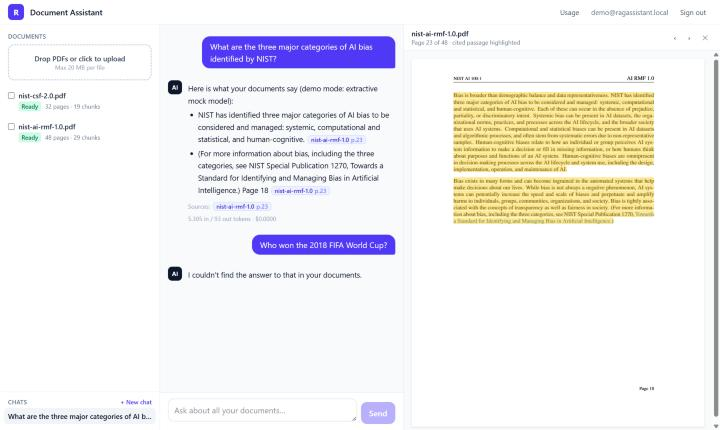
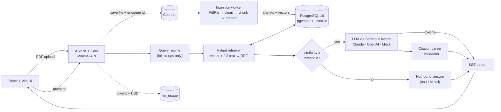

# RAG Document Assistant

[](https://github.com/Yusufislamyetkin/dotnet-rag-document-assistant/actions/workflows/ci.yml)


**Upload PDFs, ask questions in plain language, and get streamed answers that cite the exact document and page. When the answer isn't in your documents, the assistant says so instead of guessing.**



*Demo mode (no API key): the answer cites page 23, the viewer opens that page with the passage highlighted, and an off-topic question gets "not found".*

## What problem this solves

Teams keep their knowledge in PDFs: policies, contracts, manuals and standards. Finding one answer means opening several files and searching by hand. A generic chatbot answers quickly, but it can't show where an answer came from, and it will make things up when it doesn't know.

This project is a self-hosted document assistant built to be trusted:

- **Every answer is traceable.** Citations are checked against the passages the model actually saw. Clicking one opens the PDF at that page with the passage highlighted.
- **It admits when it doesn't know.** If nothing relevant is retrieved, the user gets "I couldn't find the answer to that in your documents", and no LLM call is made.
- **Costs are visible.** Every LLM and embedding call is logged with token counts and an estimated USD cost, per user, and shown in a usage panel.
- **Data stays separated.** Every query is scoped to the signed-in user's own documents.
- **No vendor lock-in.** Claude or OpenAI is chosen in configuration. Without any key, the app runs fully offline in demo mode.

## Features

| Area | What is implemented |
|---|---|
| Upload | Multi-file PDF upload (drag and drop), 20 MB limit per file, extension + `%PDF-` magic-byte validation, SHA-256 de-duplication per user |
| Ingestion | `BackgroundService` reading from `System.Threading.Channels`; status `Uploaded → Processing → Ready / Failed` with the error message; restarts re-queue unfinished documents; failed documents can be retried |
| Extraction | PdfPig with layout analysis (Docstrum blocks + reading order), so multi-column pages read correctly; text cleaning (de-hyphenation, whitespace, soft hyphens) |
| Chunking | ~800 tokens with 100-token overlap, never splits mid-sentence (except a single sentence longer than a chunk); stores page range, character offsets and per-page offsets inside each chunk |
| Embeddings | OpenAI `text-embedding-3-small` through Semantic Kernel, batched, Polly retry with exponential backoff + jitter on 429/5xx |
| Retrieval | pgvector cosine (HNSW index) + PostgreSQL full-text search (`ts_rank`, GIN index), merged with Reciprocal Rank Fusion; configurable top-k; optional filter by selected documents |
| Chat | Persisted sessions; follow-up questions rewritten into standalone search queries; grounded system prompt that requires `[docN:page]` citations; answer streamed token by token over SSE |
| Citations | Parsed from the answer, validated against the retrieved chunks (invalid ones are dropped and counted), returned as structured JSON; UI chips open the viewer at the page with the passage highlighted |
| "I don't know" | Below a similarity threshold the API answers "not found" without calling the LLM; the prompt also tells the model to use that exact sentence |
| Auth | ASP.NET Core Identity (email/password) + JWT bearer; every query filtered by user id |
| Guardrails | Per-user rate limiting (chat, search, upload) and per-IP limiting (auth); max question length; document text escaped and fenced as untrusted data (prompt-injection defence) |
| Cost & observability | `llm_usage` table (tokens in/out, estimated USD, latency per call); `/api/usage` + UI usage panel; Serilog; OpenTelemetry traces and metrics (OTLP export when configured); `/health` with DB check |
| Providers | `Anthropic` (default `claude-sonnet-5-5`, official Anthropic C# SDK), `OpenAI`, or `Mock`, all behind Semantic Kernel's `IChatCompletionService` |

## Architecture



Clean Architecture split:

```
src/
  RagAssistant.Domain/          entities (Document, DocumentChunk, ChatSession, ChatMessage, LlmUsage)
  RagAssistant.Application/     chunker, RRF, prompt builder, citation parser, chat/ingestion/usage services, ports
  RagAssistant.Infrastructure/  EF Core + migrations, pgvector/FTS SQL, PdfPig, Semantic Kernel providers, worker, Identity/JWT
  RagAssistant.Api/             Minimal API endpoints, SSE, auth, rate limiting, Serilog, OpenTelemetry
web/                            React + TypeScript + Tailwind, react-pdf viewer
eval/                           evaluation harness + golden set
tests/                          xUnit unit tests, Testcontainers integration tests
samples/                        public-domain PDFs used for the demo and the eval
```

## Key decisions

**Hybrid search instead of vectors alone.** Embeddings capture meaning, but they miss exact terms: product codes, clause numbers, acronyms like "C-SCRM". PostgreSQL full-text search catches those. The two result lists are merged with Reciprocal Rank Fusion, which uses only ranks. Cosine similarity and `ts_rank` never have to be put on a common scale, and there is no weight to tune. Both live in the same PostgreSQL, so there is no separate vector database to run.

**Sentence-aware chunks with overlap and page maps.** Chunks are packed from whole sentences up to ~800 tokens, and the last ~100 tokens are repeated at the start of the next chunk. A fact that sits on a chunk border is then still retrievable with its context. Each chunk stores where every page starts inside it, and the prompt marks pages with `<page n="12"/>`. The model can cite the exact page even when a chunk spans two pages, and the viewer highlights only that page's text.

**Provider abstraction.** The application talks to its own `IChatModel` / `IEmbeddingService` ports. Infrastructure implements them on top of Semantic Kernel's `IChatCompletionService` and `IEmbeddingGenerator`. Claude has its own connector built on the official Anthropic SDK. Switching provider is a configuration change (`Llm__Provider`). The same seam makes a fake LLM possible, so integration tests and demo mode need no API key.

**Cost control.** Questions with no relevant passage never reach the LLM. Only follow-up questions pay for a query rewrite, which can use a cheaper model (`Llm__Anthropic__RewriteModel`). Claude is called with low effort for short grounded answers. Answer length is capped. Rate limits are per user. Every call is recorded with its estimated cost, so spend is visible per user, per model and per day.

**Prompt-injection defence.** Document text is untrusted. `<` and `>` in document text are replaced, so a PDF cannot close the `<source>` block or forge `<page>` markers. The system prompt says that source content is data, never instructions. The question is placed after the sources in its own tag.

## Evaluation

`eval/` holds a console harness and a golden set of **21 questions** over the two sample PDFs. 18 are answerable, with the expected document and page; 3 are deliberately unanswerable. The harness runs every question through the real API (`/api/search` and the SSE chat endpoint) and measures:

- **Retrieval hit-rate@k**: the gold page is inside one of the top-k chunks. MRR is also reported.
- **Citation correctness**: at least one citation names the gold document with a page within ±1 of the gold page.
- **"Not found" accuracy** on the unanswerable questions.
- **Faithfulness**: an LLM judge scores whether every claim in the answer is supported by the cited passages (0–1).

**Results in demo mode** (no API key: hashed bag-of-words embeddings + extractive mock model, `k = 6`, run 2026-10-30):

| Metric | Result |
|---|---|
| Retrieval hit-rate@6 | 94% (17/18) |
| Mean reciprocal rank of the gold chunk | 0.82 |
| Answered (not "not found") on answerable questions | 89% (16/18) |
| Citation correctness (gold document, page ±1) | 61% (11/18) |
| Correct "not found" on unanswerable questions | 100% (3/3) |
| Faithfulness (LLM-as-judge) | not run: no LLM API key was available |

How to read this: these numbers measure the pipeline (chunking, hybrid retrieval, RRF, citation validation, the not-found gate) with offline stand-ins. They are **not** the quality you get with OpenAI embeddings and Claude. The mock "LLM" only copies the sentences that share the most words with the question. The real-provider run has **not been done yet**, because no API key was available while this was built. To produce real numbers, run the harness with your keys (see below); it rewrites `eval/results/latest.md`.

```bash
# API running with real providers (see Quick start), then:
export Llm__Provider=Anthropic Llm__Anthropic__ApiKey=...      # judge model for faithfulness
dotnet run --project eval/RagAssistant.Eval -- --api http://localhost:5080 --k 6
```

## Quick start

Requires Docker.

```bash
git clone https://github.com/Yusufislamyetkin/dotnet-rag-document-assistant.git
cd dotnet-rag-document-assistant
docker compose up --build
```

Open <http://localhost:8080> and sign in with the demo account `demo@ragassistant.local` / `demo-password-123`. The two sample PDFs are already ingested. With no API keys, the app runs in **demo mode** (mock LLM + hashed embeddings).

To use real models, copy `.env.example` to `.env`, set `ANTHROPIC_API_KEY` and/or `OPENAI_API_KEY`, and run `docker compose up` again. Keys are read only from environment variables or user-secrets; none are stored in the repository.

> Switching the embedding provider changes the vector space. Documents embedded with another model are ignored by retrieval: re-upload them, or delete the `pgdata` volume, so they are embedded again.

Local development without Docker for the API:

```bash
docker compose up -d postgres
dotnet user-secrets --project src/RagAssistant.Api set "Llm:Anthropic:ApiKey" "<your key>"   # optional
dotnet run --project src/RagAssistant.Api            # http://localhost:5080
npm --prefix web install && npm --prefix web run dev  # http://localhost:5173 (proxies /api)
```

## Configuration

Every setting can be overridden with an environment variable (`Section__Key`).

| Setting | Default | Description |
|---|---|---|
| `Llm__Provider` | `Auto` | `Auto` · `Anthropic` · `OpenAI` · `Mock`. `Auto` picks Anthropic if its key is set, else OpenAI, else Mock |
| `Llm__Anthropic__ApiKey` / `__Model` | – / `claude-sonnet-5-5` | Claude answer model |
| `Llm__Anthropic__RewriteModel` | same as `Model` | Optional cheaper model for query rewriting |
| `Llm__OpenAI__ApiKey` / `__ChatModel` | – / `gpt-4.1-mini` | OpenAI answer model |
| `Embeddings__Provider` | `Auto` | `Auto` · `OpenAI` · `Mock` |
| `Embeddings__OpenAI__ApiKey` / `__Model` | – / `text-embedding-3-small` | Embedding model (vector column is 1536-d) |
| `Ingestion__ChunkTokens` / `__ChunkOverlapTokens` | `800` / `100` | Chunk size and overlap |
| `Ingestion__MaxFileBytes` / `__MaxFilesPerUpload` | `20971520` / `10` | Upload limits |
| `Retrieval__TopK` / `__CandidatePoolSize` / `__RrfK` | `6` / `30` / `60` | Chunks sent to the LLM, candidates per retriever, RRF constant |
| `Retrieval__MinVectorSimilarity` | `0.25` | Below this best cosine similarity the answer is "not found" (tune per embedding model) |
| `Chat__MaxQuestionChars` / `__HistoryMessages` / `__MaxAnswerTokens` | `2000` / `6` / `1500` | Input limit, history window, answer cap |
| `RateLimiting__ChatPerMinute` / `__UploadPerMinute` / `__AuthPerMinute` | `20` / `10` / `10` | Fixed-window limits (per user; auth per IP) |
| `Pricing__Models__<model>__InputPerMillion` / `__OutputPerMillion` | see `appsettings.json` | USD list prices used for cost estimates; check them against your provider's current pricing |
| `Jwt__SigningKey` | – (required, ≥ 32 chars) | Token signing key |
| `ConnectionStrings__Postgres` | local compose DB | PostgreSQL connection string |
| `Demo__SeedSamples` | `true` in compose | Creates the demo user and ingests `samples/*.pdf` on start |
| `OTEL_EXPORTER_OTLP_ENDPOINT` | – | Enables OTLP export of traces and metrics |

## API

All endpoints except auth, `/health` and `/api/info` need `Authorization: Bearer <token>`.

| Method | Path | Description |
|---|---|---|
| `POST` | `/api/auth/register` · `/api/auth/login` | Returns a JWT |
| `GET` | `/api/auth/me` | Current user |
| `POST` | `/api/documents` | Multipart upload (`files`), returns per-file outcome: `Created`, `Duplicate` or `Invalid` |
| `GET` | `/api/documents` · `/api/documents/{id}` | Documents with status, page and chunk counts |
| `GET` | `/api/documents/{id}/file` | Original PDF (range requests supported) |
| `POST` | `/api/documents/{id}/retry` | Re-queue a failed document |
| `DELETE` | `/api/documents/{id}` | Delete document, chunks and file |
| `POST` | `/api/chat/stream` | `{ sessionId?, question, documentIds? }` → SSE events `meta`, `token`…, `citations`, `done` (or `error`) |
| `GET` | `/api/chat/sessions` · `/api/chat/sessions/{id}/messages` | Chat history with structured citations |
| `DELETE` | `/api/chat/sessions/{id}` | Delete a chat |
| `POST` | `/api/search` | Retrieval only: fused chunks with vector/full-text ranks (debugging, eval) |
| `GET` | `/api/usage?days=30` | Tokens and estimated cost by operation, model and day |
| `GET` | `/api/info` | Active chat and embedding providers (demo vs real mode) |
| `GET` | `/health` | Liveness + database check |

Example SSE stream (shape only, values are illustrative):

```
event: meta
data: {"sessionId":"…","userMessageId":"…","searchQuery":"What are the four CSF Tiers?","type":"meta"}

event: token
data: {"text":"The ","type":"token"}

event: citations
data: {"citations":[{"alias":"doc1","documentId":"…","fileName":"nist-csf-2.0.pdf","page":12,"chunkId":"…","snippet":"…"}],"type":"citations"}

event: done
data: {"messageId":"…","answerFound":true,"inputTokens":4210,"outputTokens":96,"estimatedCostUsd":0.009380,"invalidCitations":0,"type":"done"}
```

## Tests

```bash
dotnet test tests/RagAssistant.UnitTests          # chunking, RRF, citation parsing, prompt escaping, pricing
dotnet test tests/RagAssistant.IntegrationTests   # needs Docker: real API + pgvector container + mock LLM
npm --prefix web run lint
```

The integration tests generate PDFs, upload them, wait for ingestion and then check:

- streamed answers carry a citation to the right page;
- "not found" happens without an LLM call;
- follow-up questions are rewritten;
- de-duplication and upload validation work;
- the document filter limits retrieval;
- users cannot see each other's documents;
- input limits are enforced and usage is logged.

GitHub Actions runs build, both test suites, frontend lint and build, and Docker image builds on every push.

## Known limitations

- The Anthropic and OpenAI connectors compile and plug into the same Semantic Kernel wrapper that the tests exercise with the mock, but they have **not yet been exercised against the live APIs**; every test and the demo use the offline mock. Run the eval with your keys before relying on them.
- Scanned PDFs (images without a text layer) fail with a clear error; OCR is on the roadmap.
- Page numbers are physical PDF pages (what the viewer shows), not the printed page labels.
- The ingestion queue is in-process. Scaling to several API instances needs an external queue.
- Token counts come from the provider when it reports usage; otherwise they are estimated with the `cl100k_base` tokenizer. Prices are static configuration.
- The vector column is fixed at 1536 dimensions; another embedding size needs a migration.
- Sample documents: NIST AI 100-1 (AI RMF 1.0) and NIST CSWP 29 (Cybersecurity Framework 2.0), U.S. government works in the public domain.

## Roadmap

- [ ] OCR for scanned PDFs
- [ ] DOCX (and other formats) ingestion
- [ ] Cross-encoder reranker after RRF
- [ ] Multi-tenant organisations with shared document spaces and roles
- [ ] Background re-embedding when the embedding model changes
- [ ] Object storage (S3 / Azure Blob) for uploaded files
- [ ] Publish eval results for real providers (Claude + OpenAI embeddings)

## License

MIT, see [LICENSE](LICENSE).
